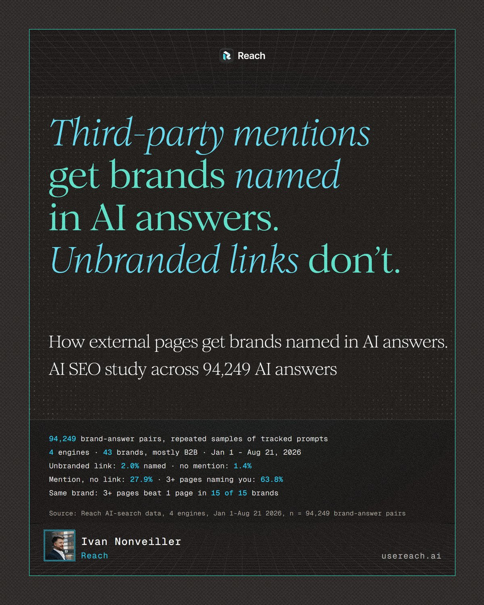
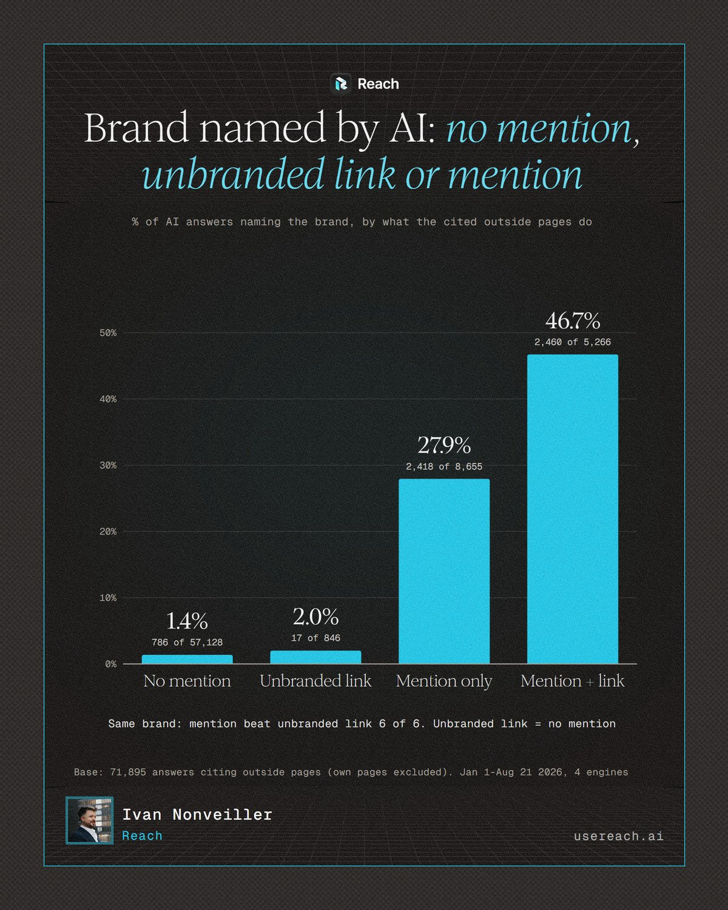
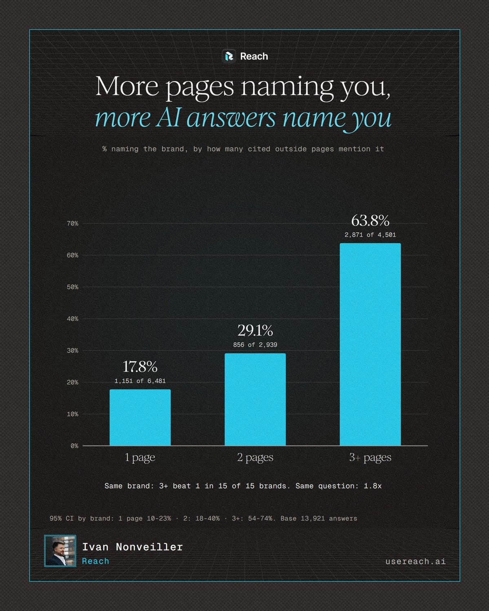
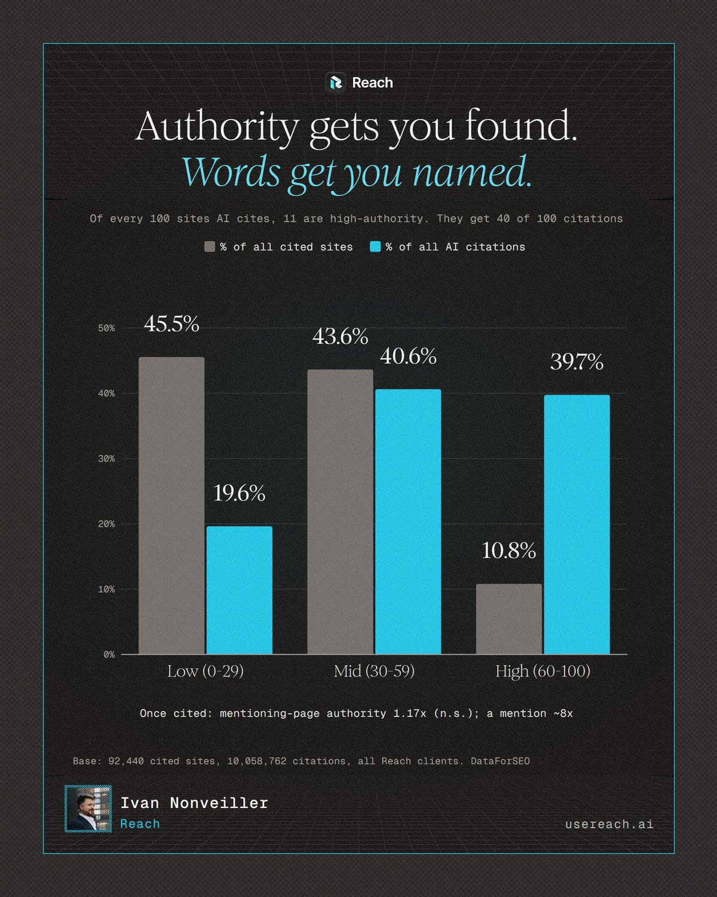

# Third-Party Mentions Study 2026

**Third-party mentions get brands named in AI answers. Unbranded links don't.**

Methodology and aggregated data for the Third-Party Mentions study by [Ivan Nonveiller](https://github.com/IvanNon) at [Reach](https://usereach.ai). This repo holds only aggregated, anonymized tables. No brand names, prompts, answer text or page URLs.

Follow-up to the [Ghost Citations Study 2026](https://github.com/IvanNon/ghost-citations-study-2026).

**Full write-up:** [third-party-mentions-study-2026.pdf](https://github.com/IvanNon/third-party-mentions-study-2026/raw/main/third-party-mentions-study-2026.pdf)

## Preview

Click any page to download the full 10-page PDF. All pages are in [`images/`](images).

## Question

**Among the third-party pages an AI answer cites, what makes the answer say the brand's name?**

- A **third-party page** is a cited page that is not on the brand's own domain.
- A **mention** means the brand name appears in that page's text.
- An **unbranded link** means the page links to the brand's domain but never names the brand.
- **Named** means the AI answer itself says the brand.

## Headline results

| Finding | Number |
|---|---|
| Brand named when no cited third-party page mentions it | **1.4%** (786 of 57,128) |
| Brand named when a cited page only links to it, without naming it | **2.0%** (17 of 846) |
| Brand named when a cited page mentions it, no link | **27.9%** (2,418 of 8,655) |
| Brand named when a cited page mentions it and links to it | 46.7% (2,460 of 5,266) |
| Named rate by pages mentioning the brand: 1 / 2 / 3+ | **17.8% / 29.1% / 63.8%** |
| Same brand: 3+ mentioning pages beat 1 page | **15 of 15 brands** (3.3x, Mantel-Haenszel) |
| Same brand and same prompt: 3+ vs 1 mentioning page | 1.8x (181 vs 75 prompts) |
| Same brand: mention (no link) beat unbranded link | **6 of 6 brands** (p = 0.03). Unbranded link vs no mention: 3 vs 3 brands, no difference |
| At the same number of mentioning pages, link vs no link (1 page) | 17.3% vs 17.9% |
| Cited sites with authority 60-100 (DataForSEO) | 10.8% of cited sites, 39.7% of all AI citations |

The "mention + link" rate is higher mainly because linked answers cite more mentioning pages. With the same number of mentioning pages, a link adds little (1 and 2 pages), and is ahead only at 3+ (not tested within brand).

Same pattern on all 4 engines (no mention → mention, no link → mention + link): AI Mode 1.7 → 36.1 → 50.1%, AI Overviews 1.1 → 32.1 → 51.1%, ChatGPT 2.4 → 30.9 → 48.8%, Perplexity 0.4 → 16.8 → 38.3%.

## Method

- **Source:** Reach's production data. Tracked prompts for 43 client brands with distinctive names, run on four engines: ChatGPT, Perplexity, Google AI Mode and Google AI Overviews. Read-only, aggregate statistics only.
- **Unit:** a brand × answer pair. 94,249 pairs, every 2nd day, Jan 1 – Aug 21, 2026, up to 250 pairs per engine-day. Prompts repeat over time, so the 94,249 are repeated samples of the same tracked prompts.
- **Bases:** 94,249 pairs → 71,895 cite third-party pages with snapshot data (own-page and no-data answers excluded) → 13,921 with at least one cited page mentioning the brand.
- **"Mention":** word-bounded match of the brand name in the main text of Reach's stored snapshot of each cited page.
- **"Link":** the page's extracted outbound links include the brand's domain. Pages without outlink data form a separate "link unknown" group.
- **"Named":** Reach's answer-extraction flag (`is_mentioned`), not text matching.
- **Confidence intervals:** 95%, bootstrap over brands (2,000 resamples), because the same brands and prompts repeat.
- **Within-brand checks:** Mantel-Haenszel stratified by brand, with a two-sided sign test on brands. Within-prompt checks stratify by brand × prompt.
- **Authority:** DataForSEO domain rank (0–100) for every cited domain in Reach, all clients.

## Data

All files are in [`data/`](data). Percentages are in percent, not fractions.

| File | What it contains |
|---|---|
| `named_rate_by_cited_page_signal.csv` | Named rate with 95% CI for no mention, unbranded link, mention without link, mention + link. |
| `named_rate_by_mentioning_pages.csv` | Named rate with 95% CI for 1, 2 and 3+ mentioning pages, split by link vs no link. |
| `named_rate_by_engine.csv` | Named rate per engine for no mention, mention without link, mention + link. |
| `within_brand_mentioning_pages_anonymised.csv` | Per-brand named rate at 1, 2 and 3+ mentioning pages, for the 14 brands with 10+ answers in each group. Brands relabelled A–N by volume. |
| `within_brand_mention_vs_unbranded_link_anonymised.csv` | Per-brand named rate for mention without link, unbranded link and no mention, for the 6 brands with 5+ unbranded-link answers. Brands relabelled A–F. |
| `cited_sites_by_authority.csv` | Cited sites and citations by DataForSEO authority band, with average citations per site. |

## Caveats

- **Only pages AI already cites.** The study explains what gets a brand named once a page is in the answer, not how pages get cited.
- **Partly mechanism.** An AI answer can only repeat a name the page contains. The finding is useful as a mechanism, not proof that backlinks are useless: authority (largely backlinks) goes with being cited more often.
- **Search answers only.** Covers AI answers that use search. What the model knows from training also affects naming and isn't measured here.
- **Small base for unbranded links.** 846 answers from 14 brands; only 6 brands qualify for the within-brand test.
- **Question mix.** Within the same prompt, the 1 → 3+ effect is smaller (1.8x) than pooled (3.3x within brand).
- **Correlational.** Snapshots may differ from the page the engine saw. Mostly B2B/SaaS brands. Aug 22+ excluded because of collection and extraction changes.
- **1.4% with no mention:** AI can still name a brand from its own knowledge or from the prompt wording.

## License

Content in this repo (README, data, PDF and images) is licensed under [CC BY 4.0](LICENSE). Share and adapt it with attribution.

## Cite

Nonveiller, I. (2026). *Third-Party Mentions Study 2026*. https://github.com/IvanNon/third-party-mentions-study-2026

GitHub's "Cite this repository" button is powered by [`CITATION.cff`](CITATION.cff).

Questions or challenges: open an issue.
